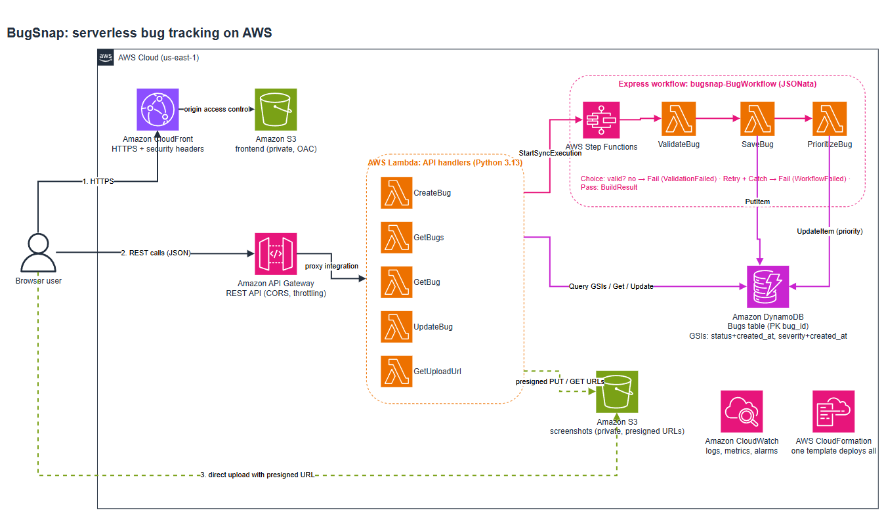
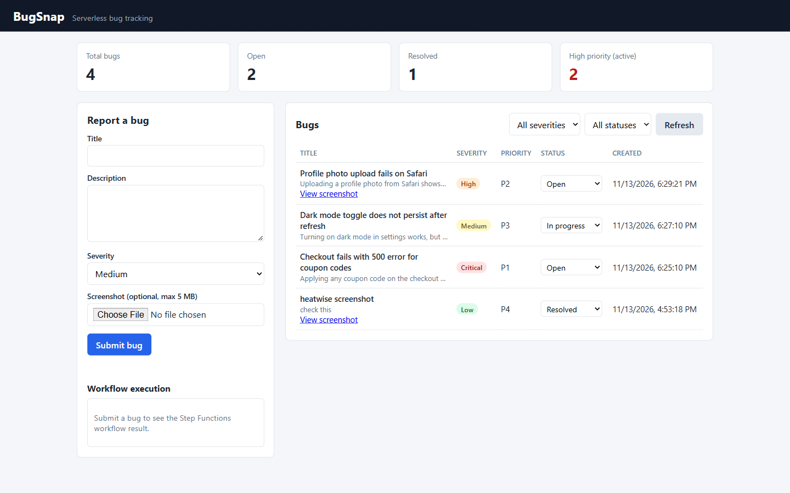

# BugSnap

Serverless bug tracking and workflow automation on AWS: S3, CloudFront, API Gateway, Lambda, DynamoDB, Step Functions and CloudWatch, deployed with a single CloudFormation template. No servers, no containers, no CI/CD.





More in [`docs/screenshot/`](docs/screenshot): [failed workflow](docs/screenshot/02-workflow-failed.png) (validation rejected) and [succeeded workflow](docs/screenshot/03-workflow-succeeded.png) (bug saved and prioritized). AWS console views: [CloudFormation resources](docs/screenshot/04-cloudformation-resources.png) [Step Functions executions](docs/screenshot/05-step-functions-executions.png) and [API Gateway routes](docs/screenshot/06-api-gateway-routes.png), [DynamoDB indexes](docs/screenshot/08-dynamodb-indexes.png) and [CloudWatch Logs dashboard](docs/screenshot/07-cloudwatch-logs-dashboard.png). Account details in the console shots are replaced with placeholders or blurred.

- Architecture details: [docs/architecture.md](docs/architecture.md) (editable diagram: [docs/architecture.drawio](docs/architecture.drawio))
- API reference: [docs/api.md](docs/api.md)
- Write-up: [Builder Center article](docs/builder-center-article.md), [cost analysis](docs/cost-analysis.md), [findings](docs/findings.md), [demo video script](docs/demo-video-script.md)

## The problem

Small teams lose bug reports in chat threads and need a place to submit, prioritize and track them, without running a server for it. BugSnap is a bug tracker that costs close to nothing when idle: every service is pay-per-request.

## What it does

- Submit a bug (title, description, severity, optional screenshot).
- A Step Functions workflow validates it, saves it to DynamoDB and assigns a priority from the severity (critical = P1, high = P2, medium = P3, low = P4). Invalid reports fail with a clear message.
- Dashboard shows total, open, resolved and high-priority counts, filters by severity and status, status updates, and the result of each workflow execution.

## Layout

```
frontend/             HTML/CSS/JS dashboard (config.js is generated at deploy time)
lambda/src/           Python Lambda functions (+ common.py)
infra/template.yaml   CloudFormation template (everything, including the state machine)
tests/e2e_test.py     end-to-end tests against the deployed stack
docs/                 architecture (drawio, png, md), API reference, cost analysis, findings, article, video script
docs/screenshot/      dashboard, workflow and AWS console screenshots
```

## Prerequisites

- AWS CLI v2 with credentials for the target account (permissions to create CloudFormation, IAM roles, S3, CloudFront, Lambda, API Gateway, DynamoDB, Step Functions and CloudWatch resources).
- PowerShell. Python 3 for the tests only.
- API Gateway access logs need the account-level CloudWatch role to be set in the region (`aws apigateway get-account`). This template does not create it, so it never takes over an existing setting.

## Deploy

```powershell
./scripts/deploy.ps1                                    # stack "bugsnap", us-east-1
./scripts/deploy.ps1 -StackName bugsnap -Region us-east-1
```

The script creates a small artifact bucket for the Lambda package, runs `aws cloudformation package` and `deploy`, uploads the frontend with the real API URL in `config.js`, and invalidates the CloudFront cache. It prints the API URL and website URL (the first CloudFront deploy takes a few minutes).

Why the script and not only `aws cloudformation deploy`: CloudFormation does not republish an API Gateway deployment when only methods change, so the script gives the deployment resource a content-hash logical ID.

## What gets created

| Resource | Details |
|---|---|
| CloudFront distribution | HTTPS, security headers, origin access control to the frontend bucket |
| S3 `bugsnap-frontend-<acct>-<region>` | Private, encrypted, TLS-only; readable only by CloudFront |
| S3 `bugsnap-attachments-<acct>-<region>` | Private, encrypted, TLS-only, CORS for the site; accessed with presigned URLs |
| API Gateway `bugsnap-api` (stage `prod`) | 5 routes, CORS, throttling, access logs |
| Lambda x8 | ValidateBug, SaveBug, PrioritizeBug, CreateBug, GetBugs, GetBug, UpdateBug, GetUploadUrl (Python 3.13, one least-privilege role each) |
| DynamoDB `bugsnap-Bugs` | PK `bug_id`, on-demand, encrypted, point-in-time recovery, GSIs on `status` and `severity` (sorted by `created_at`) |
| Step Functions `bugsnap-BugWorkflow` | Express, JSONata, Lambda tasks with retries, Choice / Pass / Fail states |
| CloudWatch | Log groups for each Lambda, the state machine and API access logs (14-day retention); alarms for workflow failures and API 5xx |

Idle cost is close to zero. The small fixed items are the two CloudWatch alarms, DynamoDB point-in-time recovery and S3 storage.

## Test

```powershell
python tests/e2e_test.py bugsnap us-east-1          # 29 checks, then deletes its test items
python tests/e2e_test.py bugsnap us-east-1 --keep   # keep the test items
```

The tests call the real API, S3 and CloudFront. They cover validation failure, all severity-to-priority mappings through Step Functions, get/list/filter/stats, status updates, 404s, screenshot upload and privacy, CORS preflight, HTTPS and security headers on the site, and that the frontend bucket is not publicly readable.

Manual check: open the website URL, submit a bug (try an empty title to see the workflow fail), change a status, use the filters.

## Monitoring

- Lambda logs: `/aws/lambda/bugsnap-<Function>`
- Workflow executions: `/aws/vendedlogs/states/bugsnap-BugWorkflow` (input and output of every state)
- API access logs: `/aws/apigateway/bugsnap-access`
- Alarms: `bugsnap-workflow-failures`, `bugsnap-api-5xx`

## Redeploy after changes

Run `./scripts/deploy.ps1` again.

Note: DynamoDB allows only one global secondary index to be added per stack update. A fresh deploy creates both indexes with the table; an upgrade of an older table needs two updates.

## Cleanup

```powershell
./scripts/cleanup.ps1
```

Empties both stack buckets, deletes the stack (including the table) and removes the artifact bucket.

## Scope and limits

- No sign-in: the API is open to anyone with the URL, and throttling (20 requests/second, burst 40) is the only protection. To harden it, add a Cognito user pool and an API Gateway Cognito authorizer; the HTTPS CloudFront domain is already usable as the sign-in callback URL.
- `GET /bugs` returns the 200 newest matching bugs; the stats cover all bugs.

## License

MIT, Copyright (c) 2026 Dineshraj Dhanapathy. See [LICENSE](LICENSE).
