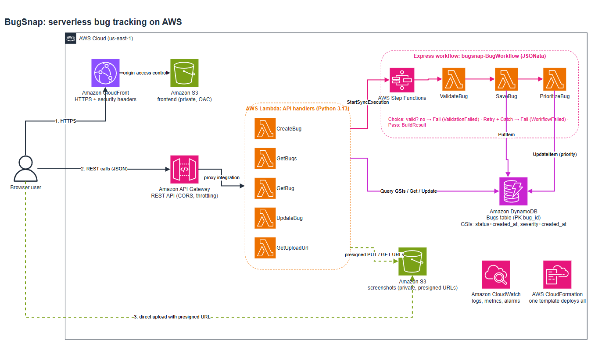
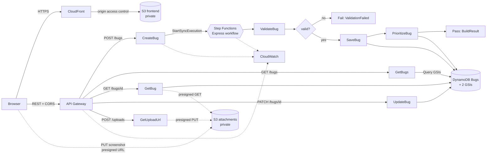

# BugSnap architecture

Editable diagram with AWS icons: [architecture.drawio](architecture.drawio) (open in https://app.diagrams.net or the draw.io VS Code extension).

The same flow as text:

## Request flows

- **Open the app**: browser -> CloudFront (HTTPS) -> private S3 bucket through origin access control.
- **Submit**: `POST /bugs` -> CreateBug -> Step Functions (Express, synchronous) -> ValidateBug -> Choice -> SaveBug -> PrioritizeBug. The API returns the bug ID, priority and workflow execution status, and the UI shows them in the "Workflow execution" panel.
- **Screenshot**: `POST /uploads` returns a presigned PUT URL; the browser uploads straight to the private bucket and sends the `attachment_key` with the bug. `GET /bugs/{id}` returns a 5-minute presigned GET URL.
- **List and stats**: GetBugs queries two DynamoDB global secondary indexes (`status` + `created_at`, `severity` + `created_at`). There is no table Scan.

## Design decisions

| Decision | Reason |
|---|---|
| Express workflow + `StartSyncExecution` | One request returns bug ID, priority and workflow status. Full execution history goes to CloudWatch Logs. |
| Lambda task integrations | Simplest reliable option; each step stays easy to test. |
| One Lambda code folder, one function and role per handler | One package, least-privilege IAM per function. |
| CloudFront + origin access control | HTTPS for the site and no public bucket. Costs nothing when idle. |
| Presigned URLs for screenshots | The attachment bucket stays fully private (Block Public Access on, TLS-only policy). |
| DynamoDB GSIs instead of Scan | Listing and counting read only the matching index partitions. |
| CORS locked to the CloudFront origin | Set in API Gateway OPTIONS and error responses, Lambda responses and the attachment bucket CORS rules. |
| Deploy script hashes the API deployment ID | CloudFormation does not republish API Gateway when only methods change; a content-hash logical ID forces it. |

## Scope and limits

- The API is open: there is no sign-in. Anyone with the URL can read and create bugs. Throttling (20 req/s, burst 40) limits abuse. For real use add a Cognito authorizer; CloudFront already provides the HTTPS callback URL it needs.
- `GET /bugs` returns the 200 newest bugs matching the filter. Stats cover all bugs.
- The template does not create `AWS::ApiGateway::Account`; it relies on the account-wide CloudWatch role already set for API Gateway in the region.
