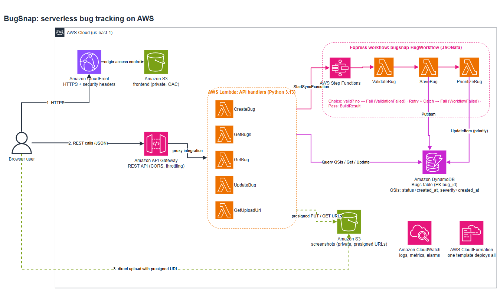
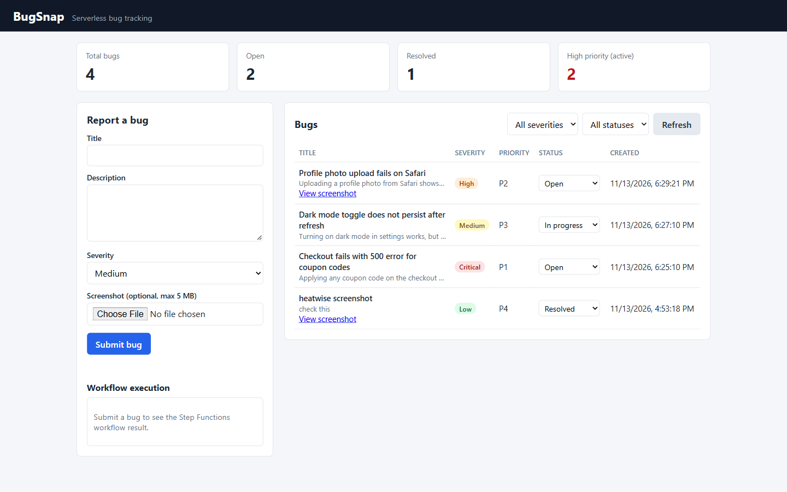

# BugSnap: a bug tracker with no servers, built on Step Functions

Bug reports get lost in chat threads. BugSnap is a small bug tracker that runs entirely on serverless AWS services, validates and prioritizes every report with a Step Functions workflow, and costs about 20 cents a month when nobody is using it.

- Code: [add your GitHub link here]
- Demo video (under 3 minutes): [add your YouTube/Vimeo link here]
- Deploy it yourself: one script, one CloudFormation template, about 10 minutes (most of it CloudFront).





## The problem

Small teams track bugs in chat, spreadsheets or email. Reports arrive with no severity, no owner and no status, and nobody can answer "how many high-priority bugs are still open?" Running a full tracker means a server to patch or a SaaS seat for every reporter. I wanted the smallest useful version that has no server to run and bills close to nothing while idle.

## What BugSnap does

- Anyone can report a bug: title, description, severity and an optional screenshot.
- A workflow checks the report, stores it and assigns a priority from the severity: critical is P1, high is P2, medium is P3, low is P4.
- A bad report is rejected with a clear message ("title is required") and the dashboard shows that the workflow failed.
- The dashboard lists bugs, filters by severity and status, updates status, and shows total, open, resolved and high-priority counts plus the result of each workflow execution.

## The serverless services and how they connect

| Service | Role |
|---|---|
| Amazon CloudFront + S3 | Serves the HTML/CSS/JS dashboard over HTTPS from a private bucket (origin access control) |
| Amazon API Gateway (REST) | Five routes: `POST /bugs`, `GET /bugs`, `GET /bugs/{id}`, `PATCH /bugs/{id}`, `POST /uploads` |
| AWS Lambda (Python 3.13) | Eight functions, one least-privilege IAM role each |
| AWS Step Functions (Express) | The bug submission workflow |
| Amazon DynamoDB | `Bugs` table with two global secondary indexes |
| Amazon S3 (second bucket) | Private screenshot storage, reached with presigned URLs |
| Amazon CloudWatch | Logs for every function, the state machine and the API; two alarms |
| AWS CloudFormation | The whole stack in one template |

How a request moves:

1. The browser loads the dashboard from CloudFront.
2. Submitting a bug calls `POST /bugs`. API Gateway invokes the CreateBug Lambda, which starts the Step Functions workflow synchronously.
3. The workflow runs ValidateBug, then a Choice state. Invalid input goes to a Fail state with the error list. Valid input continues to SaveBug (writes to DynamoDB) and PrioritizeBug (sets the priority), then a Pass state builds the result.
4. CreateBug returns `201` with the bug ID, priority and workflow status, or `400` with the validation errors. The dashboard shows the execution name, status and duration.
5. Screenshots skip the API payload: the browser asks `POST /uploads` for a presigned URL and uploads straight to the private bucket. `GET /bugs/{id}` returns a five-minute download link.
6. The list endpoint queries DynamoDB indexes (status + created_at, severity + created_at), newest first. There is no table Scan.

## The workflow

The state machine is an Express workflow written in JSONata, defined inline in the template. It is invoked with `StartSyncExecution`, so the API can answer in the same request.

```json
{
  "StartAt": "ValidateBug",
  "States": {
    "ValidateBug": { "Type": "Task", "Resource": "arn:aws:states:::lambda:invoke",
      "Output": "", "Next": "IsValid" },
    "IsValid": { "Type": "Choice",
      "Choices": [{ "Condition": "", "Next": "SaveBug" }],
      "Default": "ValidationFailed" },
    "ValidationFailed": { "Type": "Fail", "Error": "ValidationFailed",
      "Cause": "" },
    "SaveBug": { "Type": "Task", "...": "Lambda invoke, retries, catch", "Next": "PrioritizeBug" },
    "PrioritizeBug": { "Type": "Task", "...": "Lambda invoke, retries, catch", "Next": "BuildResult" },
    "BuildResult": { "Type": "Pass", "End": true }
  }
}
```

(Shortened. The full definition, with retries on Lambda service errors and a catch-all to a `WorkflowFailed` state, is in `infra/template.yaml`.)

The Fail state's `Cause` carries the list of validation errors, so CreateBug can turn it into a normal `400` response with details.

## Data model

`Bugs` table, partition key `bug_id`, on-demand capacity, encryption and point-in-time recovery on. Attributes: `title`, `description`, `severity`, `priority`, `status`, `created_at`, `updated_at`, and an optional `attachment_key`.

Two global secondary indexes, `status-created_at-index` and `severity-created_at-index`, serve the list screen and the counters without scanning the table.

## Security

- Both buckets are private. The dashboard bucket can only be read by the CloudFront distribution; screenshots only through presigned URLs that expire in five minutes. The tests check that direct requests to both buckets return 403.
- Each Lambda has its own IAM role with only the DynamoDB, S3 or Step Functions actions it needs.
- CORS is restricted to the CloudFront origin, on the Lambda responses, the preflight responses, the gateway's own error responses and the screenshot bucket.
- Input is validated in the workflow (length limits, allowed severities, attachment key prefix).
- The API itself has no sign-in. Throttling (20 requests per second, burst 40) is the only protection. This is the main limit of the build, and the next step is a Cognito authorizer.

## Deploying and reusing the pattern

I used plain CloudFormation with the AWS CLI. No SAM, no CDK, no containers, no pipeline.

```powershell
./scripts/deploy.ps1      # package Lambda code, deploy the stack, publish the site
./scripts/cleanup.ps1     # empty buckets and delete everything
```

To reuse the pattern: keep your Lambda code in a folder, point each `AWS::Lambda::Function` `Code` property at it, and let `aws cloudformation package` upload it. The deploy script also covers two things CloudFormation does not do for you: it republishes the API Gateway deployment when methods change, and it writes the API URL into the site's `config.js`.

## Testing against the real stack

`tests/e2e_test.py` makes 29 checks against the deployed resources, with no mocks: validation failure, every severity-to-priority mapping through Step Functions, get/list/filter/stats, status updates, 404s, screenshot upload and privacy, CORS preflight, HTTPS and security headers on the site, and that the frontend bucket is not public. It cleans up the items it creates.

## Screenshots

All in the repo's `docs/screenshot/` folder: the dashboard, a rejected submission, a successful submission, and the AWS console views of the CloudFormation stack (58 resources), the Step Functions executions, the API Gateway routes, the DynamoDB indexes and the CloudWatch Logs dashboard. Account details in the console shots are replaced with placeholders or blurred.

## What it costs

Idle: about $0.20 a month, all of it the two CloudWatch alarms. 10,000 bugs and 50,000 dashboard loads in a month comes to roughly $0.80, plus a dashboard-stats read cost that grows with stored data (up to about $8 in the worst case I calculated). Unit prices are from the AWS Price List API; the totals are my estimates. Details: [cost-analysis.md](cost-analysis.md).

## What I learned

The longer list is in [findings.md](findings.md). The ones I would pass on:

- A synchronous Express workflow lets an API return a workflow result in one request.
- CloudFormation does not republish an API Gateway deployment when only methods change. Real-stack tests caught this; mocks would not have.
- DynamoDB lets you add only one global secondary index per update, and the index must finish backfilling before code uses it.
- A Step Functions "failed" metric also counts rejected user input, so alarm on something else.

## Limits and what is next

- No authentication (Cognito authorizer is the planned next step).
- The list returns the newest 200 matches; pagination tokens are next.
- Dashboard counters use COUNT queries, which cost more as the table grows; maintained counters would fix that.

## License

MIT, Copyright (c) 2026 Dineshraj Dhanapathy.
